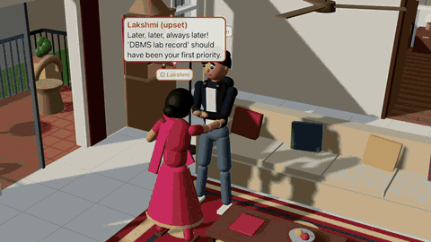

# AI Family World

A persistent, autonomous simulation of a five-member Indian family (Rajesh, Lakshmi, Arjun, Priya, Anu) with a live 2D dashboard and a 3D house view.

[](docs/demo.mp4)

*Click the preview to watch the full video with sound ([docs/demo.mp4](docs/demo.mp4)).*

## Purpose

Watch AI agents live believable family life: they follow daily routines, juggle tasks and deadlines, talk, argue and make up, remember what happened, and learn from it day by day. You step in as the "controller" by giving instructions, assigning tasks or triggering events, and you see how each member reacts based on their personality, mood and relationships. Use it as a sandbox for agent behaviour, emergent storytelling, or as a reference for keeping an LLM-backed simulation cheap, reproducible and bounded.

## Tech stack

| Part | Technology | Version |
|------|-----------|---------|
| Runtime | Python | 3.12 |
| Web server | FastAPI + Uvicorn | 0.162 / 0.54 |
| Storage | SQLite (Python stdlib) | — |
| LLM (optional) | Anthropic Python SDK, Claude Haiku/Sonnet/Opus 5.5 | 2.3 |
| 2D dashboard | Plain HTML + Canvas (no build step) | — |
| 3D house | React, Three.js, @react-three/fiber, @react-three/drei | 18.3 / 0.169 / 8.18 / 9.122 |
| 3D build tool | Vite | 5.4 |
| Node (only to rebuild the 3D view) | Node.js | 20+ |

## Install

Prerequisites: Python 3.12 and [uv](https://docs.astral.sh/uv/) (or plain `pip`). Node.js is only needed if you change the 3D view, because a prebuilt copy ships in `static/3d/`.

```bash
git clone https://github.com/shreyas411/ai-family-world.git && cd ai-family-world
uv venv --python 3.12 .venv && uv pip install --python .venv/bin/python -r requirements.txt
# without uv: python3.12 -m venv .venv && .venv/bin/pip install -r requirements.txt
```

Optional: `export ANTHROPIC_API_KEY=...` (and/or `OPENAI_API_KEY`, `GEMINI_API_KEY`) before starting. An LLM then voices the dialogue and parses instructions. Without a key, everything still runs on the rule-based engine at no cost.

## Usage

```bash
.venv/bin/python server.py          # → http://localhost:8000 (3D house at /3d/)
.venv/bin/python test_sim.py        # headless 4-day run with assertions (DAYS=7 for longer)
.venv/bin/python test_llm.py        # LLM gateway: routing, provider fallback, metering, monthly budget (no network)
.venv/bin/python bench.py claude-haiku-5-5 claude-sonnet-5-5 --judge claude-sonnet-5-5   # compare models on identical scenarios
```

1. Open http://localhost:8000 and press **Start**. The clock advances 10 simulated minutes per tick, and the speed is adjustable.
2. Watch the feed, the member cards (each shows its reasoning as 💭) and the tabs for relationships, memories, tasks and reports.
3. Use the controller panel to message the family ("Arjun, finish your assignment before games"), assign tasks, trigger events or run scenarios. See [Controller](#controller).
4. Open **🏠 Open 3D house** to watch the same simulation in 3D, or use **Replay** to replay any past day.

State is saved to `world.db`, so the world continues after a restart. **Reset world** in the controller starts over.

## Architecture

```
server.py   FastAPI: REST + WebSocket push, async tick loop, serves the dashboard
world.py    The simulation: clock, schedules, decisions, emotions, relationships, tasks, memory, learning, events, reports
llm.py      Optional LLM gateway (Anthropic / OpenAI / Google): dialogue voicing + instruction parsing, model routing,
            provider fallback, per-agent token + cost metering, monthly budget cap
bench.py    Benchmarks models on identical seeded scenarios: format checks, judge score, latency, cost
static/index.html   Dashboard: canvas house, feed, 8 tabs, replay, screenshot, video recording
world.db    SQLite: world state (JSON), event log, conversations, history frames, daily reports
```

**Deterministic engine, LLM only for language.** Every state change (who goes where, who talks, whether an argument happens, how emotions and relationships move) is decided in `world.py` from personality, emotion, memory, relationship and task state. Claude only rewrites the engine's draft lines into natural speech. As a result:
- costs are bounded: at most one call per conversation, plus one per controller instruction, against a monthly USD budget
- routing: routine talk and instructions use each member's `model` (default Claude Haiku 5.5); arguments, apologies and high-tension moments use their `model_complex` (default Claude Sonnet 5.5). Both are set per member in the controller
- if a model's provider fails, the call is retried once on the configurable fallback model (default `gemini-2.5-flash`), then falls back to the rule-based lines
- each prompt carries only the speakers' top 4 relevant memories, no conversation history; daily reports are built from the event log with no LLM call
- **🔊 Speak** (dashboard header) reads new conversations aloud with the browser's speech synthesis: free, no server call. Tamil lines use a `ta-IN` voice, English and Tanglish an `en-IN` voice, and pitch varies by age and role so members sound different. For Tamil on macOS, add a Tamil voice under System Settings → Accessibility → Spoken Content → System voice → Manage Voices; on Windows, add the Tamil language pack with speech; Chrome on Android usually has one built in
- dialogue language: **English** (Indian English, default), **Tamil** (Tamil script) or **Tanglish** (Tamil-English mix in Latin script), set under *LLM & cost* in the controller. It only applies to LLM-voiced lines; without an API key the template dialogue stays in English. Benchmark a language with `LANGUAGE=Tamil .venv/bin/python bench.py ...`
- the controller shows live calls, tokens (including cached), average latency and estimated cost per member and per model
- the simulation is reproducible from its seed, and it can't run away into endless agent-to-agent loops
- it works offline

**Each tick (10 simulated minutes)** every awake agent at home scores its options: follow the schedule, work on a task, take a break, rest, or start one of ~10 conversation types. Scores come from priority, deadline urgency, conscientiousness, learned discipline, energy, mood, and a temptation term. The winner is applied, and the reasoning is shown on the member card as 💭. Repeated actions are damped by cooldowns (240 min per pair+topic), a leisure-streak penalty, and a cap of two conversations per tick.

**Emotions:** 17 emotions with 0–1 intensity. Deltas are scaled by personality (neurotic members react more to negative events), and every emotion decays toward that member's own baseline.

**Relationships:** directed pairs, each with trust, affection, respect, frustration, understanding and closeness. They change through conversations. Arguments emerge when computed tension passes 0.55, which depends on defensiveness, patience, current anger and existing frustration. They are recorded as unresolved conflicts until someone apologises and the other person forgives.

**Memory:** each agent has its own short-term memory (last 25), episodic memory (importance ≥ 0.6), and long-term daily summaries. Only participants and people in the same room remember a conversation. Private controller messages reach only their target, and Anu's broken-vase secret stays hers. Recall ranks memories by importance, recency and the people involved.

**Carry-over:** an unresolved argument doesn't reset overnight. The next morning both members wake with residual anger and sadness, and a "still upset" memory. Relationship frustration between them doesn't fade until someone apologises and is forgiven. Arguments left unresolved for 3 days fade, and are recorded as "never talked through".

**Witnesses:** participants remember the whole conversation. Silent bystanders in the room remember only what they saw (an 8-year-old remembers "they were shouting, it scared me"). During an argument, members in other rooms remember only that they heard raised voices. Each conversation lists who remembers it and how.

**Said vs did:** every claim a member makes about a task is recorded: "it's almost done", "finished already", or "I'll do it" in reply to an instruction. The claim is checked against the task's real progress when it completes or misses its deadline. A false claim that gets exposed costs trust with the person who was told, and a parent who was lied to before won't take the next "almost done" calmly. Being caught teaches an honesty lesson, which is measured like the other lessons.

**Learning with evidence:** at midnight each agent reflects. Failing tasks after postponing them teaches "start earlier" (a discipline modifier). Arguments teach patience, exhaustion teaches asking for help, and helping teaches helpfulness. Two days later each lesson is marked effective or not effective based on the metric it targets (completion rate, argument count, end-of-day energy, affection received). Habits slowly fade unless they are reinforced.

**Visualization:** a 2D canvas floor plan with avatars that glide between rooms, emotion emoji, speech bubbles, controller announcements and a night tint. Replay rebuilds any past day from stored frames, with a "story of the day" timeline (who started each conversation and why, every argument's cause and how it ended). Clicking a moment jumps there, and a caption on the house explains the conversation in progress. Screenshot exports a PNG and Record exports a WebM of the canvas. The view labels itself a schematic of recorded state: the drawing is illustrative, while the positions, actions and words are real simulation output.

## 3D house

`http://localhost:8000/3d/` (or **🏠 Open 3D house** on the dashboard) shows the same simulation as a furnished 3D Indian home: living room, kitchen, dining area, parents' and children's bedrooms, study, bathroom, balcony, hallway and entrance, plus a compound wall, a gate and a street. The 2D dashboard is unchanged; both views read the same WebSocket and replay APIs.

- **Driven only by simulation state.** Each member's `location`, `activity` and `mood` from the backend maps to a spot (bed, sofa seat, dining chair, desk, stove...) and an animation (`web3d/src/planner.js`). Nothing moves unless the backend says so. Members walk A* routes on a 25 cm grid that blocks walls, railings and furniture, so they use doors (`nav.js`). "Talking with X" makes them walk over and face X. Arguments make both stand up, with gestures and an "argument" subtitle. Apologies use a reconcile gesture. Mood sets eyebrows, mouth and posture.
- **Camera:** dollhouse view with cutaway walls, orbit/zoom/pan, click a room to zoom in and inspect it (who is there, what was said), click a person (or use Follow) for a follow camera, and **Whole house** to return.
- **Replay** plays a recorded day. The clock pauses while each conversation plays out, and chips jump to each argument and apology. **📷** saves a PNG; **⏺ Record** saves a WebM of the 3D canvas.
- **Performance:** procedural low-poly models with shared geometries and materials, and procedural canvas textures (no downloads). There is one AnimationMixer per character with shared clips. **Graphics: low** turns off shadows and room lights and renders at 0.75× resolution. The renderer only reads state; it never slows the simulation.
- **Character looks:** the five rigs are styled after the family reference art (Rajesh's blue shirt and moustache, Lakshmi's pink saree and bun, Arjun's navy hoodie and headphones, Priya's lavender sweater and long hair, Anu's pink unicorn tee and pigtails). Kids carry backpacks only while heading out or coming home. The HUD shows portraits cropped from the same art (`web3d/public/avatars/<id>.jpg`).
- **Reading activities:** each name tag carries an activity icon (💤 sleeping, 🍳 cooking, 📺 TV, 🎮 gaming, 📞 call, 🎨 sketching, 💻 computer, ✏️ homework, 🤒 caring for someone sick, 💬 talking, 💢 arguing…), and every icon has its own animation and hand props.
- **Swapping in real assets:** characters are procedural rigs (named joint hierarchy + AnimationMixer clips: idle, walk, relax, eat, study, type, read, phone, tea, cook, chop, clean, groom, pray, talk, sitTalk, argue, crossed, reconcile, sleep, toys). To use a rigged GLB instead, put it in `web3d/public/models/` and map it in `manifest.json` (`"father": "/3d/models/father.glb"`). Clips with those names are played. The house and furniture are code in `House.jsx` / `furniture.jsx`.

Develop: `cd web3d && npm install && npm run dev` (http://localhost:5173/3d/, proxies to the Python server). Build: `npm run build` (writes `static/3d/`, served by FastAPI). Navigation check: `node nav.test.mjs`.

## Controller

Start, pause, resume, stop, reset, single-step, speed, and set day/time. You can broadcast or privately message any member in natural language. Members may accept, negotiate ("after I finish X") or refuse ("Why me?"), depending on agreeableness, anger and workload. You can also assign tasks, trigger 7 event types or free-text events, run 4 scenarios, edit names, ages, roles, traits and per-agent models, add new family members, and set the LLM on/off and budget.

## Known limitations

- Dialogue without an API key comes from templates: varied, but repetitive over many days, and English only (Tamil needs an LLM).
- Spoken audio uses the browser's built-in voices, so quality depends on the OS. Tamil needs a Tamil voice installed (otherwise a default voice mispronounces it). Conversations that arrive while one is still being read are skipped, and replay and the 3D view are silent.
- With Claude on, a single call voices all speakers in a conversation. The prompt passes each speaker only their own memories, but it is one model writing every voice.
- Weekends drop school and office but have no special routines yet. No meals or money are tracked as resources.
- Video is a browser canvas recording, not generated footage. PDF export uses the browser's print dialog.
- Single process with SQLite. That is plenty for one household; Postgres and Redis would only matter for many concurrent worlds.

## Roadmap

1. Phase 1–5 (done, simplified where noted above).
2. Next: weekend and festival routines, a family budget as a real resource, Claude-generated nightly reflections (one call per agent per day) that feed into memory, and memory retrieval by embeddings once memories grow large.
3. Then: an auto-generated "day highlights" replay that jumps between the day's important conversations.

## Contributing

See [CONTRIBUTING.md](CONTRIBUTING.md).

## License

[MIT](LICENSE)
